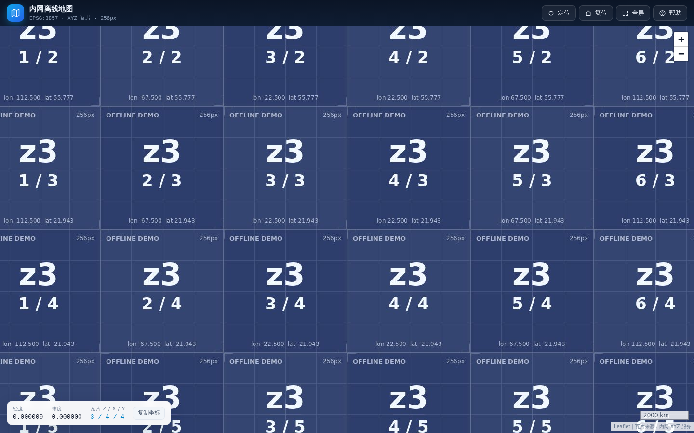

# 内网离线地图 · offline-tile-map

[](LICENSE)

一个**完全离线可部署**的 XYZ 瓦片地图查看器。整个项目只有静态文件：Leaflet 已内置，页面不加载任何 CDN、在线字体或第三方脚本；把 `config.js` 里的瓦片地址指向你已有的内网瓦片服务，就能浏览、缩放、定位和取点。

> A dependency-free, fully offline XYZ tile map viewer for intranets. Leaflet is vendored, no CDN or external assets, configured with a single `config.js`.



## 特性

- **纯静态**：无构建、无后端、无外网依赖；拷进内网目录、U 盘或镜像即可运行。
- **协议匹配**：XYZ / EPSG:3857 / 256×256 / 左上原点（y 向南），与常见内网瓦片服务一致。
- **配置简单**：瓦片 URL、缩放范围、实际瓦片级别、TMS、子域、叠加图层都在 `config.js` 中。
- **好用的交互**：经纬度与 `z/x/y` 双向定位、实时坐标读数、点击取点并复制、全屏、比例尺。
- **故障可见**：瓦片加载失败、超时、HTTPS 混合内容都会给出明确提示和重试入口。
- **开箱即用**：自带 0–3 级演示瓦片和本地测试瓦片服务，没有真实数据也能跑通全流程。
- **可部署**：附带 Docker / Nginx 配置，以及坐标数学单测和浏览器端到端测试。

## 快速开始

**在线演示**：<https://map.open-claw.click>（使用内置演示瓦片，仅用于查看界面与交互）

### 1. 先看效果（内置演示瓦片）

```bash
git clone https://github.com/lizhemin15/offline-tile-map.git
cd offline-tile-map

python3 -m http.server 8080      # 或：npm run serve
```

打开 <http://localhost:8080>。默认使用 `demo/tiles/` 中的合成瓦片（仅 0–3 级，放大后是前端拉伸），用于确认页面、交互和部署链路正常。

也可以直接双击 `index.html` 打开；但用 HTTP 服务访问更接近实际部署环境。

### 2. 接入你的内网瓦片服务

编辑根目录的 `config.js`，只改 `tile` 和 `view` 即可：

```js
window.MAP_CONFIG = {
  title: '内网离线地图',
  tile: {
    url: 'http://<瓦片服务器IP>:12345/map/gsm/{z}/{x}/{y}.jpg',
    minZoom: 0,
    maxZoom: 11,
    maxNativeZoom: 11,   // 服务实际有瓦片的最高级别
    tileSize: 256,
    scheme: 'xyz'
  },
  view: {
    center: [39.9075, 116.3912],  // [纬度, 经度]
    zoom: 5
  }
};
```

保存后刷新页面。改配置不需要重新构建、重启服务（Nginx 对 `config.js` 设置了 `no-cache`）。

> 如果服务已经切到 12–18 级，把 `maxZoom` 和 `maxNativeZoom` 一起改成对应级别即可；`maxNativeZoom < maxZoom` 时，超过该级别由浏览器放大已有瓦片，不会向服务请求不存在的层级。

### 3. 部署

**Docker（推荐）**

```bash
docker compose -f deploy/docker-compose.yml up -d --build
# 访问 http://<服务器IP>:8080
```

**Nginx（裸机/虚拟机）**

```bash
sudo mkdir -p /var/www/offline-tile-map
sudo cp -r index.html config.js assets demo /var/www/offline-tile-map/
# 参考 deploy/nginx.conf 配置站点，然后：
sudo nginx -t && sudo systemctl reload nginx
```

**任意静态服务器**：把 `index.html`、`config.js`、`assets/` 放到 Web 根目录即可；`demo/` 只用于演示，可以不带。

## 瓦片协议对应关系

| 你的协议项 | 取值 | 项目中的配置 |
| --- | --- | --- |
| 瓦片方案 | XYZ | `tile.scheme: 'xyz'` |
| URL | `http://host:12345/map/gsm/{z}/{x}/{y}.jpg` | `tile.url`，保留 `{z}/{x}/{y}` |
| 投影 | EPSG:3857（Web Mercator） | Leaflet 默认 CRS，无需配置 |
| 原点 | 左上（西北角），x 向东、y 向南 | XYZ 默认行为，`scheme: 'xyz'` |
| 瓦片尺寸 | 256 × 256 | `tile.tileSize: 256` |
| 级别 | minZoom 0，maxZoom 11 | `tile.minZoom: 0`、`tile.maxZoom: 11` |
| 更高级别 | 例如已有 18 级 | `maxZoom`、`maxNativeZoom` 改为 18 |

如果遇到上下颠倒（第 0 行跑到南边），说明服务用的是 TMS，把 `scheme` 改成 `'tms'` 即可。

## 配置说明

`config.js` 中所有字段都是可选的，未填时使用内置默认值。

| 字段 | 类型 | 默认值 | 说明 |
| --- | --- | --- | --- |
| `title` | string | `内网离线地图` | 顶栏标题，同时作为浏览器标题 |
| `subtitle` | string | 自动生成 | 顶栏副标题 |
| `tile.url` | string | `demo/tiles/{z}/{x}/{y}.jpg` | 瓦片模板，必须含 `{z}` `{x}` `{y}` |
| `tile.minZoom` | number | `0` | 最小缩放级别 |
| `tile.maxZoom` | number | `11` | 允许缩放到的最大级别（0–24） |
| `tile.maxNativeZoom` | number | `3` | 服务真实存在的最大级别；超过则前端放大 |
| `tile.tileSize` | number | `256` | 瓦片边长（像素） |
| `tile.scheme` | string | `'xyz'` | `'xyz'`（左上原点）或 `'tms'`（左下原点） |
| `tile.subdomains` | array | `[]` | URL 使用 `{s}` 时的子域，如 `['a','b','c']` |
| `tile.detectRetina` | boolean | `false` | 高分屏按 2× 请求（需服务端支持） |
| `tile.attribution` | string | `瓦片来源：内网 XYZ 服务` | 右下角来源说明 |
| `view.center` | `[lat, lng]` | `[0, 0]` | 初始中心点（纬度在前） |
| `view.zoom` | number | `3` | 初始缩放级别 |
| `ui.coords` | boolean | `true` | 显示经纬度 / 瓦片读数面板 |
| `ui.scale` | boolean | `true` | 显示比例尺 |
| `ui.zoom` | boolean | `true` | 显示缩放按钮 |
| `ui.locate` | boolean | `true` | 显示定位按钮 |
| `ui.help` | boolean | `true` | 显示帮助按钮 |
| `ui.fullscreen` | boolean | `true` | 显示全屏按钮（浏览器不支持时自动隐藏） |
| `overlays` | array | `[]` | 叠加图层，字段同 `tile`，另有 `name`、`opacity` |

叠加图层示例：

```js
overlays: [
  { name: '影像', url: 'http://10.0.0.8:8080/img/{z}/{x}/{y}.png', opacity: 1 },
  { name: '标注', url: '/tiles/labels/{z}/{x}/{y}.png', opacity: 0.9 }
]
```

### 临时覆盖配置（联调）

不改文件也能试不同瓦片服务，URL 参数会覆盖 `config.js`：

```
http://localhost:8080/?tile=http://127.0.0.1:12345/map/gsm/{z}/{x}/{y}.jpg&minZoom=0&maxZoom=11&maxNativeZoom=11&center=116.3912,39.9075&zoom=8
```

支持 `tile`（或 `url`）、`minZoom`、`maxZoom`、`maxNativeZoom`、`tileSize`、`scheme=tms`、`center=经度,纬度`、`zoom`。参数中的大括号建议 URL 编码（`%7Bz%7D`）。

## 界面操作

- **拖动**平移，**滚轮 / 双击**缩放，缩放按钮在右上角。
- **定位**：支持 `116.3912, 39.9075`（经度, 纬度）或 `5/26/12`（z/x/y）；纬度写在前面时会在合法范围内自动识别。
- **点击地图**放置标记，弹窗可复制该点经纬度与瓦片编号。
- **底部读数**随鼠标实时更新；点击「复制坐标」复制当前位置。
- 快捷键：`L` 定位、`R` 复位、`F` 全屏、`?` 帮助、`Esc` 关闭弹窗。
- 帮助面板会显示当前生效的瓦片地址、投影、瓦片尺寸和缩放范围，方便现场排查。

## 反向代理：解决 HTTPS 混合内容与跨域

如果地图页面用 HTTPS 部署，而瓦片地址是 `http://…`，浏览器会以混合内容为由拦截。推荐用 Nginx 把瓦片代理到同源，`deploy/nginx.conf` 中已备好注释块：

```nginx
location /tiles/ {
    proxy_pass http://<瓦片服务器IP>:12345/;
    proxy_set_header Host $host;
    add_header Access-Control-Allow-Origin "*" always;
}
```

然后把 `config.js` 改为：

```js
url: '/tiles/map/gsm/{z}/{x}/{y}.jpg'
```

这样浏览器只访问地图站点自身，既没有混合内容，也没有跨域和暴露内网地址的问题。

> 普通 `` 瓦片跨域加载**不需要**服务端 CORS；只有用 Canvas 读取像素、导出图片时才需要。

## 在本地搭一套测试瓦片

没有真实瓦片时，可以用项目自带的测试服务验证任意级别（含 11 级以上）：

```bash
pip install "Pillow>=10"          # 仅测试瓦片服务需要
python3 tools/dev_tile_server.py --port 12345
```

服务路径与内网协议一致：

```
http://127.0.0.1:12345/map/gsm/{z}/{x}/{y}.jpg
```

启动后打开地图并临时指定该服务：

```
http://localhost:8080/?tile=http://127.0.0.1:12345/map/gsm/{z}/{x}/{y}.jpg&maxZoom=11&maxNativeZoom=11&center=116.3912,39.9075&zoom=11
```

测试服务还提供 `/__stats`（各层级请求统计）和 `/__reset`，以及 `--emit demo/tiles --emit-max-zoom 3` 用来导出完全静态的瓦片目录。

## 开发与测试

```bash
npm install
npm test                 # 坐标 / 瓦片数学单测（Node 内置 test runner）
npx playwright install chromium
npm run test:e2e         # 无头浏览器冒烟测试，产出 docs/screenshot.png
```

端到端测试会校验：瓦片真实加载且无损坏、坐标读数格式、点击取点弹窗、经纬度与 `z/x/y` 定位、**没有任何外部网络请求**、控制台无报错。

## 目录结构

```
offline-tile-map/
├── index.html                 页面结构
├── config.js                  ★ 运行时配置（部署后改这里）
├── assets/
│   ├── css/app.css
│   ├── img/                   图标、缺失瓦片占位图
│   ├── js/app.js              地图初始化与交互
│   ├── js/coord.js            EPSG:3857 / XYZ 换算（可单测）
│   └── vendor/leaflet/        内置 Leaflet 1.9.4，无 CDN
├── demo/tiles/                0–3 级演示瓦片
├── deploy/
│   ├── Dockerfile
│   ├── docker-compose.yml
│   └── nginx.conf             含可选的反向代理配置
├── tools/
│   ├── dev_tile_server.py     本地 XYZ 测试瓦片服务
│   └── static_server.mjs      零依赖静态服务器
├── tests/
│   ├── coord.test.mjs
│   └── e2e.mjs
└── docs/screenshot.png
```

## 常见问题

**地图只有灰底 / 提示瓦片加载失败**

按 F12 打开网络面板，先直接访问一个具体瓦片，例如 `http://host:12345/map/gsm/5/26/12.jpg`。确认：端口和防火墙、URL 前缀、`{z}/{x}/{y}` 顺序、该级别是否真的存在。也可以打开帮助面板核对当前生效的地址。

**高倍放大后模糊**

当前缩放级别超过 `maxNativeZoom`，浏览器在放大低级别瓦片。把 `maxNativeZoom` 调成服务真实的最高级别；如果服务只有 11 级，这是预期行为。

**瓦片上下颠倒 / 错位**

把 `scheme` 从 `'xyz'` 改为 `'tms'`（或反向）。另一种错位来自底图本身的坐标系（如 GCJ-02 与 WGS84 混用），本项目只做显示，不做纠偏。

**HTTPS 页面加载 HTTP 瓦片被拦截**

见上文「反向代理」。控制台会提示 `Mixed Content`。

**改了 config.js 不生效**

浏览器或代理缓存。Nginx 配置已对 `config.js` 设置 `no-cache`；本地可强制刷新（Ctrl/Cmd + Shift + R）。

**能直接双击 index.html 吗？**

可以，页面和演示瓦片都是相对路径。但生产环境建议用 HTTP 服务，行为与浏览器安全策略更接近实际部署。

**瓦片服务需要登录 / 带 Token**

当前版本只支持在 URL 中携带固定参数（如 `?token=xxx`），不处理动态鉴权。更稳妥的做法是通过 Nginx 反向代理统一加认证头，前端只写同源 `/tiles/...`。

## 兼容性

Chrome / Edge 90+、Firefox 90+、Safari 15+。使用了 `Promise`、`URLSearchParams`、`ResizeObserver`、原生 `<dialog>`（不支持时有降级），不支持 IE。

## License

[MIT](LICENSE)
